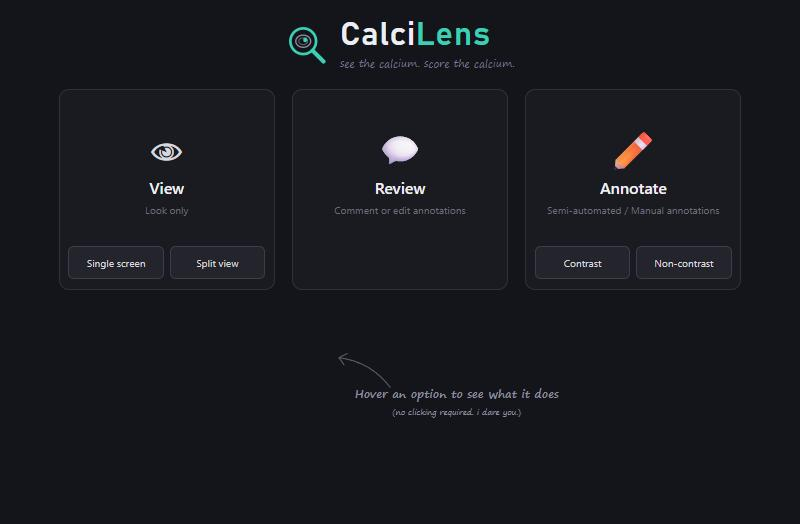
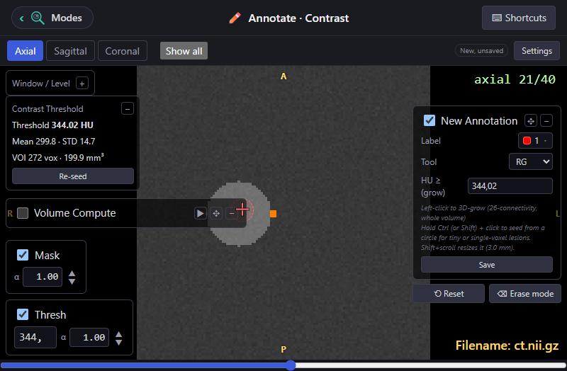
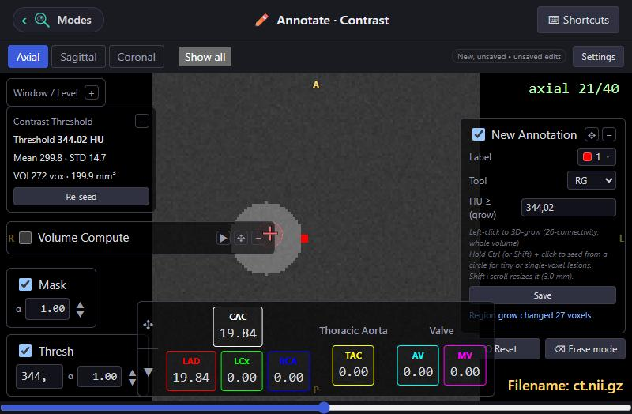

<h1 align="center">CalciLens</h1>
<p align="center"><em>see the calcium. score the calcium.</em></p>

<p align="center">
  A desktop app for looking at CT scans and annotating calcifications, quickly and safely.
</p>

<p align="center">
  
</p>

## What you can do

Pick a mode on the start screen. Each one shows only the tools it needs.

| Mode | For |
| --- | --- |
| **View** (single screen or split view) | Looking at scans and masks. Nothing can be changed or saved. |
| **Review** | Going through cases, leaving comments and reason tags. *(coming soon)* |
| **Annotate: Non-contrast** | Painting calcium labels with a fixed 130 HU threshold. |
| **Annotate: Contrast** | The same, but with a threshold worked out for each scan from a seed in the aorta. |

**Works with** NIfTI (`.nii`, `.nii.gz`), MHA/MHD, and DICOM series (pick the folder). Load one scan at a time, or point the app at a CSV/Excel sheet listing many cases and step through them with Previous / Next.

## Highlights

- **Split view** with two scans side by side, kept in sync if you want.
- **Show all**: axial, sagittal and coronal at once, linked to the same point.
- **Brush and region-grow** tools, digits `0-9` to switch label, Ctrl+click for tiny lesions.
- **Contrast scans get their own threshold.** Click the middle of the ascending aorta, press Finalize, and the app derives a threshold for that scan. Painting stays off until you do.
- **Safe saving.** You choose an output folder each session (never next to the scan). Each scan gets its own folder, nothing is overwritten without asking, and writes are atomic, so a crash can't leave a half-written file.
- **Picks up where you left off.** Choose the output folder and any saved annotation and seed for the open scan load automatically.
- **Orientation flips** (radiological / neurological, per axis) that change the display only, never the data.
- **Window/level presets**, a HU threshold overlay, editable label colours and mask opacity.

<p align="center">
  
  
</p>

## Getting started

### Windows app

Unzip the release and run `CT Viewer.exe`. Nothing else to install.

The app is not code-signed, so Windows SmartScreen may warn on first launch (choose **More info**, then **Run anyway**), and the firewall may ask about the app's local server. It only talks to your own computer.

### From source

You need Python 3.10+ and Node.js.

```bash
# one-time setup
python -m venv .venv
.venv/Scripts/activate            # macOS/Linux: source .venv/bin/activate
pip install -r server/requirements.txt
npm install
cd client && npm install && cd ..

# run
npm run app
```

`npm start` skips the rebuild if the frontend hasn't changed.

## How annotations are saved

```
<your output folder>/
  Manual_Annotations/
    <scan>/
      annotation.nii.gz     your labels
      _source.json          where it started from, when it was saved
      contrast_seed.json    the seed and threshold (contrast scans only)
```

Open the same scan again and its annotation loads. Contrast and non-contrast work on the same scan are kept apart, and the app warns you if you open one on the wrong screen.

## For developers

- `client/`: React + TypeScript (Vite) frontend
- `server/`: Python FastAPI backend (SimpleITK, NumPy, Pillow, pandas, openpyxl)
- `electron/`: desktop shell that starts the backend and opens the window

Slices are rendered on the backend and shown as plain images. There is no hot reload: run `npm run build` in `client/` after frontend changes and restart the app after backend changes. Tests: `python -m pytest server/tests`. Architecture notes and the reasoning behind design decisions are in [CLAUDE.md](CLAUDE.md).

To package the app: `npm run dist` builds an installer. Don't copy the `.venv` folder between machines; create a fresh one.
